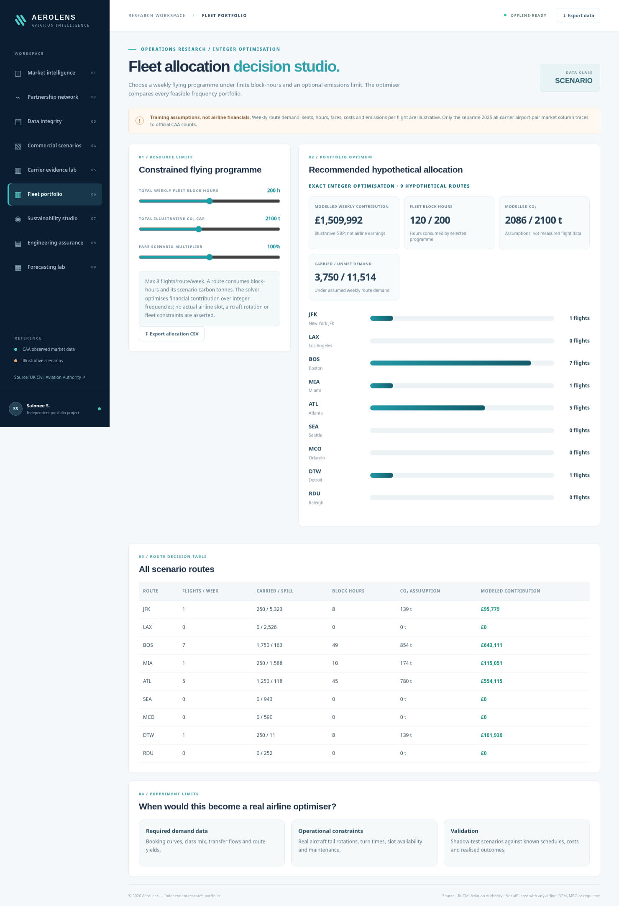

# AeroLens 3 — Aerospace & Aviation Decision Intelligence

**Interactive decision-support portfolio | data engineering | operations research | reproducible Power BI project**

AeroLens 3 is a custom-built, AI-assisted aviation and aerospace analytics portfolio project covering **traffic intelligence, time-aware network connectivity, constrained fleet allocation, emissions scenarios, engineering evidence control, capacity import, and demand forecasting**. It is deliberately **not tied to one airline or vacancy**.

This project was generated with AI assistance for Salonee Shrigandhamurthy's learning and professional portfolio. It does not demonstrate independent authorship until its intended owner has personally reviewed, extended and explained the work. No airline, regulator, OEM or supplier endorses this project.



## Get started

**Web application:** Open [`index.html`](index.html) in Chrome/Edge after extracting the folder; it works fully offline. For a single file, use `AeroLens_3_Standalone_Dashboard.html` distributed with the release. **No package installation or credentials needed for the website.**

**Editable Power BI source:** Open [`powerbi/AeroLensIntelligence/AeroLensIntelligence.pbip`](powerbi/AeroLensIntelligence/AeroLensIntelligence.pbip) in **Power BI Desktop for Windows**. It has **6 source tables, 26 DAX measures, 6 report pages and 24 built-in visual definitions**, using portable, embedded Power Query M table expressions. Details: [Power BI validation instructions](docs/POWERBI_DESKTOP_CHECKLIST.md).

**Python analytics and tests:** Python 3.11+ and standard library only.

```bash
python scripts/build_data.py
python scripts/build_advanced.py
python scripts/build_enterprise.py
python scripts/build_powerbi.py
python scripts/validate_powerbi.py
python -m unittest discover -s tests -v
```

## Nine interactive workspaces

| Workspace | What it demonstrates | Status of underlying evidence |
|---|---|---|
| 1. **Market intelligence** | Airport-pair passenger comparison, growth and data export | **Observed:** curated CAA annual 2024/2025 counts, selected 28 Heathrow–US markets, all airlines |
| 2. **Partner network simulation** | UTC-safe connections, hypothetical operator cooperation, journey scoring, Pareto tradeoffs | **Synthetic:** 154 fictional legs, fictional transfer conditions |
| 3. **Data integrity** | Traceability, checksums and the boundary between observed and modelled | **Audited curated source** and validation checks |
| 4. **Commercial scenario lab** | Seat-constrained costs, break-even and Monte Carlo sensitivity | **Scenario:** invented fares, costs, shares, departures |
| 5. **Carrier evidence workbench** | BTS T-100 CSV validation and route/carrier seat load-factor calculations | **User-supplied only:** no authentic carrier extract bundled |
| 6. **Fleet portfolio optimiser** | Exact integer weekly flight allocation with fleet-hours and carbon budgets | **Scenario:** 9 route scenarios derived from observed market scale with assumed economics |
| 7. **Sustainability studio** | Route geometry, assumed fuel usage, modelled CO₂, passenger intensity | **Scenario:** no measured flight emissions |
| 8. **Engineering assurance** | Revision/approval gates, corrective-action queue, high-priority blockers | **Synthetic:** 40 entirely fictional evidence records |
| 9. **Forecasting lab** | User monthly-file import, sequential validation, no-leakage rolling backtest and forecast bands | **User-supplied**, or explicitly marked synthetic demo; **not** derived from two annual CAA values |

## Power BI project

The repository contains **real editable PBIP / TMDL / PBIR authoring files**, *not merely DAX snippets*:

```text
powerbi/AeroLensIntelligence/
  AeroLensIntelligence.pbip
  AeroLensIntelligence.SemanticModel/
    definition.pbism
    definition/model.tmdl
    definition/database.tmdl
    definition/tables/*.tmdl    # six import tables, 26 measures
  AeroLensIntelligence.Report/
    definition.pbir
    definition/report.json
    definition/pages/*/page.json
    definition/pages/*/visuals/*/visual.json   # six pages, 24 visuals
```

**Important:** We verified JSON structure and semantic references offline, **not Power BI Desktop rendering, model refresh or successful save as PBIX**. Only Windows Power BI Desktop can finish that check. The user should open the `.pbip`, refresh, inspect the visuals and save the result. We don't represent the web dashboard as a Power BI dashboard or claim a `.pbix` was produced.

The PBIP embeds 6 small development datasets so it can be copied without broken `C:\\` paths. For ongoing refresh, replace the Power Query `#table` expressions with your own CSV/database sources and record provenance. These are small portfolio-quality input tables rather than production data warehouse volumes.

## Operational data adapters

**Official passenger source**: UK Civil Aviation Authority annual airport data 2025 Table 12.1. Source: https://www.caa.co.uk/data-and-analysis/uk-aviation-market/airports/uk-airport-data/uk-airport-data-2025/annual-2025/ . CAA data are third party; attribute and respect non-resale conditions.

**Carrier load factor from user-supplied T-100 records**:

```bash
python scripts/ingest_bts.py ./local_source/T100_international.csv --source-note "BTS T-100 original URL and date"
```

**Dated operational schedule from a user-supplied CSV**, format `flight_id,carrier,origin,destination,departure_local,arrival_local` where local timestamps include numeric UTC offsets:

```bash
python scripts/import_operations.py ./local_source/schedule.csv --source-note "Official/public/authorised schedule export, source URL and date"
```

All importers validate format, data-type and selected arithmetic or time-zone constraints, **not external authenticity, ticketing rights or operator agreements**. User-uploaded records stay local; do not upload NDA-protected operations or airworthiness documents to a public repository. Only publish data you have rights to publish.

**Monthly forecasting:** `aerolens/forecasting.py` accepts only **30+ consecutive months** of `month,passengers`. It compares two simple seasonal baselines using rolling one-step holdouts, and labels its residual band as a heuristic instead of a valid confidence interval. No fabricated seasonality is blended into the observed CAA dataset.

## Architecture and testing

- **Python**: dependency-free analytics, exact dynamic programming, time-zone graph search, schedule import, traceability checks, time-series backtest and Monte Carlo what-if experiments.
- **JavaScript**: offline interactive dashboard including browser-side counterparts of the optimisation and finance scenarios; no analytics are uploaded to any API.
- **BI**: self-contained Power Query M import tables, TMDL semantic layer, DAX KPIs, six PBIR report pages, portable project source.
- **CI**: GitHub Actions builds all generated data and Power BI metadata, runs unit tests and static report binding validation.
- **Validation**: **45 Python tests passing**, plus desktop/mobile Chromium interactions and controlled-file importer checks. Results in [test methodology](docs/VALIDATION_AND_LIMITS.md).

For design choices see [Architecture](docs/ARCHITECTURE_V3.md), [Data provenance](docs/SOURCE_REGISTER.md), and [Limitations & validation](docs/VALIDATION_AND_LIMITS.md).

## What this cannot claim

Observed CAA annual route totals **cannot establish the performance of a single airline**, actual aircraft load factors, monthly seasonality, fares, route profitability, schedules or interline settlement. Fictional scenarios are explicitly partitioned and labelled. The model cannot guarantee optimum real-world operations without tail-level schedule, maintenance windows, slots, crew constraints, calibrated demand, costs and commercial agreements. Full source export or Power BI authoring is not proof of professional BI proficiency without personally building and validating it.

## Skills and honest portfolio presentation

For relevant roles across airline network planning, aerospace operations, aviation quality, technical records, maintenance analysis, BI, supply chain and programme coordination, **the strongest demonstration is explaining what the data establish, what the assumptions omit and how you'd obtain stronger evidence**.

**Accurate description only after personally reviewing/extending the project:**

> Reviewed and extended an AI-assisted aviation analytics platform combining officially sourced airport market statistics with Python validation, scenario-based flight network planning, exact constrained fleet allocation, fictional technical record-control exercises, forecasting backtests and a version-controlled Power BI project. Separated observed market facts from illustrative operational and commercial assumptions.

Avoid claiming independent design, verified Power BI employment skills, airline-approved systems, observed emissions, actual route revenue or engineering certification.

## License

App source is available under the included MIT licence. Third-party aviation statistics retain their original attribution and usage terms. All names are for illustration or properly sourced attribution, and no organisation endorses this project.
